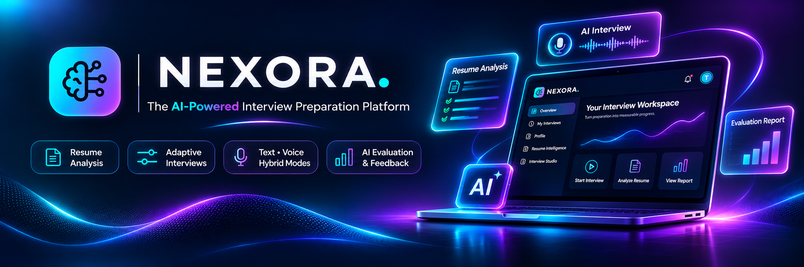
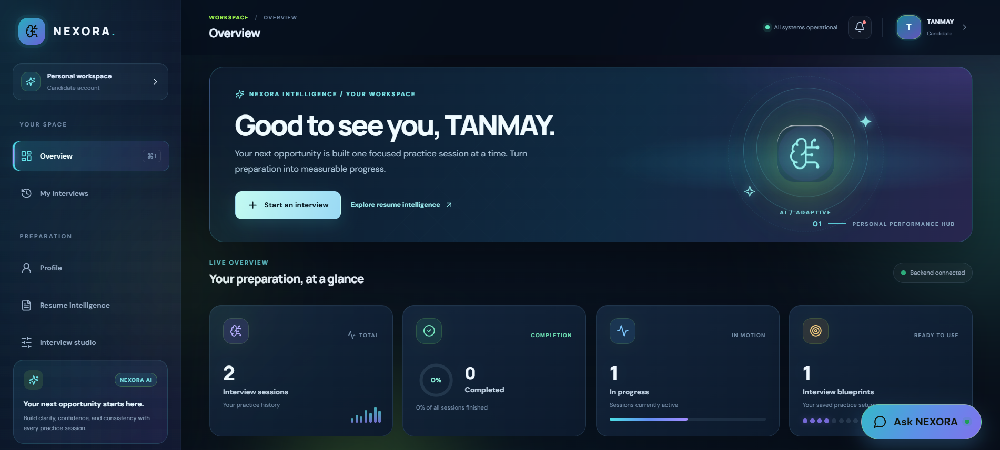
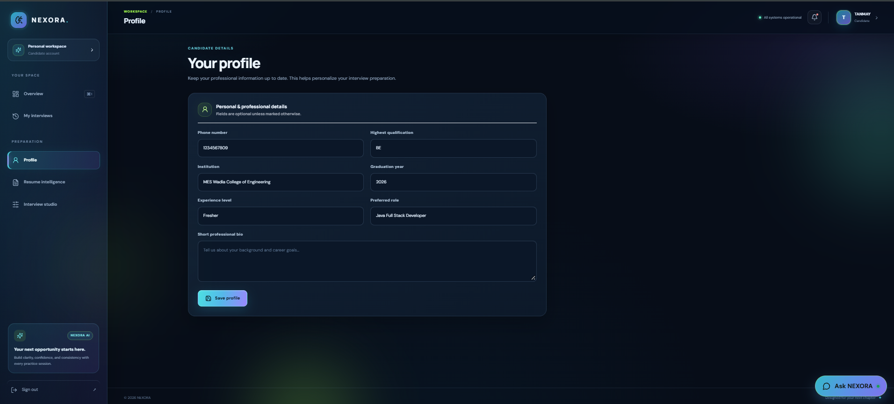
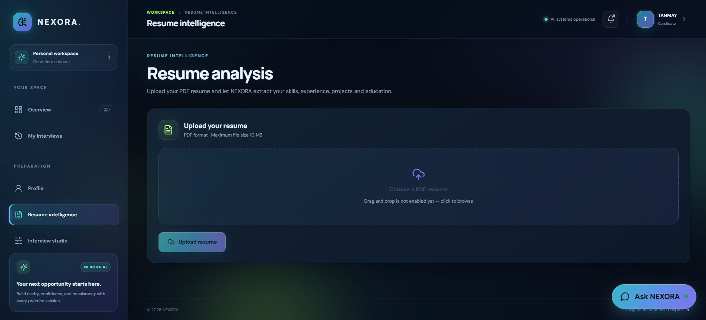
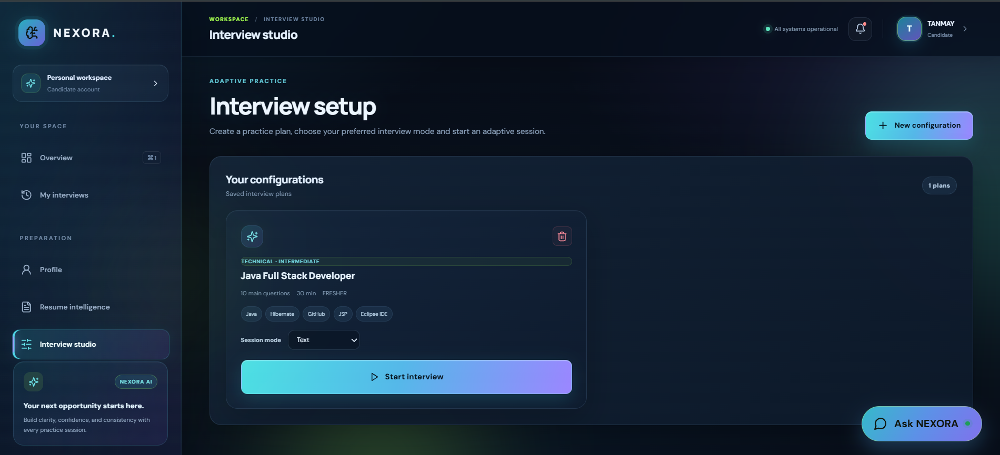
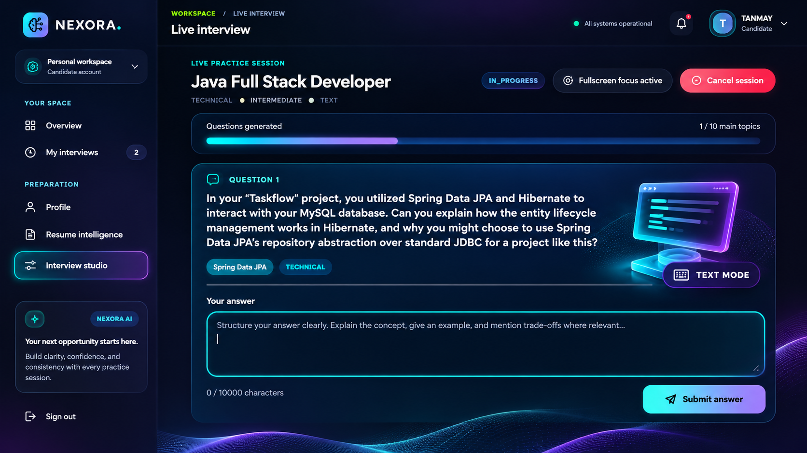
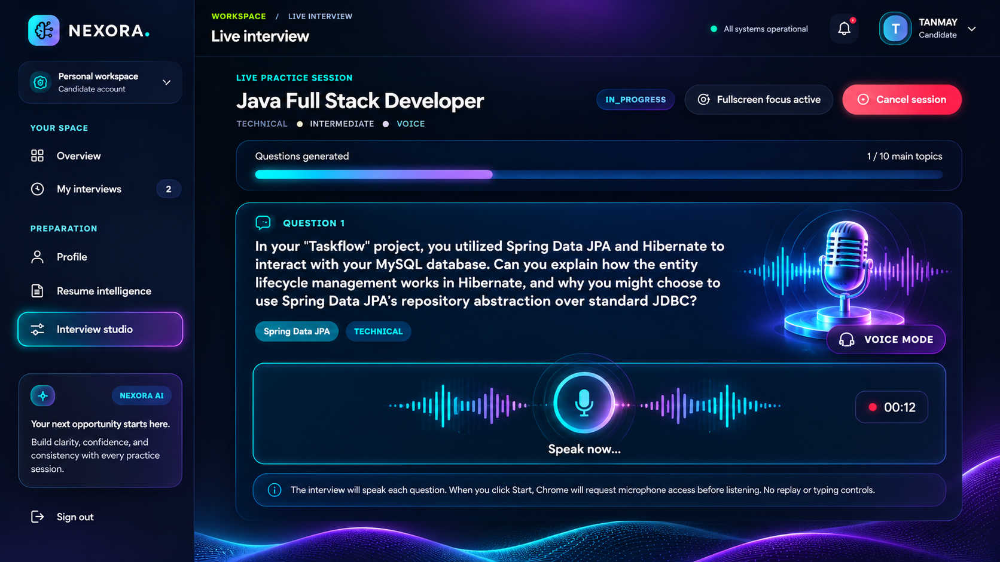
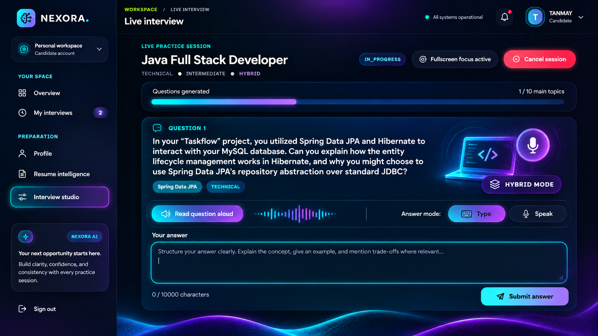
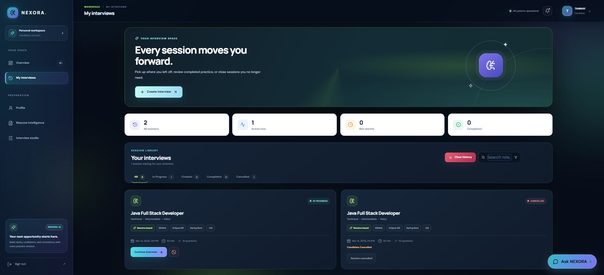
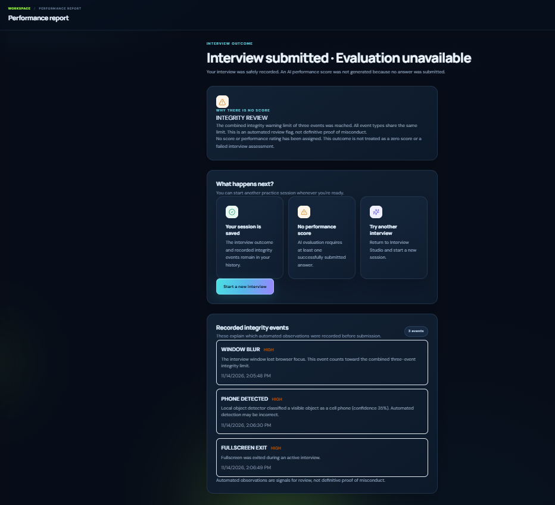

<div align="center">
  

  <br />

  <h1>NEXORA</h1>
  <h3>AI-Powered Interview Preparation Platform</h3>

  <p>
    Practice with adaptive AI interviews, analyze your resume, and review structured feedback
    through text, voice, and hybrid interview experiences.
  </p>

  <p>
    
    
    
    
    
  </p>
</div>

---

## Overview

**NEXORA** is an AI-powered interview preparation platform designed to help candidates prepare for technical and role-specific interviews. It brings resume intelligence, configurable interview practice, adaptive question generation, and AI-based evaluation into one workspace.

Candidates can upload a PDF resume, create interview plans, choose a preferred interaction mode, answer AI-generated questions, and review their interview outcomes.

## Features

| Feature | Description |
|---|---|
| **Candidate Workspace** | Dashboard for interview activity, preparation progress, and quick access to key modules. |
| **Candidate Profile** | Maintain professional details to personalize interview preparation. |
| **Resume Intelligence** | Upload a PDF resume and receive AI-assisted analysis of skills, experience, projects, and education. |
| **Interview Studio** | Create, view, and manage interview configurations based on role, topics, difficulty, and session preferences. |
| **Adaptive Interviews** | Generate contextual follow-up questions based on the candidate's previous answers. |
| **Three Interview Modes** | Practice using TEXT, VOICE, or HYBRID interaction. |
| **AI Evaluation** | Review interview performance and question-wise feedback when an evaluation can be generated. |
| **Interview History** | Revisit saved interview sessions and their outcomes. |
| **Integrity Monitoring** | Record supported integrity events and apply the combined warning policy during an active session. |
| **NEXORA AI Assistant** | Access the integrated assistant interface from the candidate workspace. |

## Application Preview

### Workspace

<p align="center">
  
</p>

### Candidate Preparation

<table>
  <tr>
    <td width="50%" align="center">
      
      <b>Candidate Profile</b>
    </td>
    <td width="50%" align="center">
      
      <b>Resume Intelligence</b>
    </td>
  </tr>
  <tr>
    <td colspan="2" align="center">
      
      <br />
      <b>Interview Studio</b>
    </td>
  </tr>
</table>

### Interview Experiences

NEXORA supports three ways to interact with the AI interviewer.

<table>
  <tr>
    <td width="33%" align="center">
      
      <b>TEXT MODE</b>
      <br />
      Type answers to AI-generated interview questions.
    </td>
    <td width="33%" align="center">
      
      <b>VOICE MODE</b>
      <br />
      Listen to questions and respond using microphone transcription.
    </td>
    <td width="33%" align="center">
      
      <b>HYBRID MODE</b>
      <br />
      Read or listen to questions and type your responses.
    </td>
  </tr>
</table>

> **Note:** The three interview-room visuals are illustrative previews based on the application's interview interface. The remaining application screenshots show the workspace screens.

### History & Evaluation

<table>
  <tr>
    <td width="50%" align="center">
      
      <b>Interview History</b>
    </td>
    <td width="50%" align="center">
      
      <b>Performance Report</b>
    </td>
  </tr>
</table>

The performance report reflects the recorded interview outcome. If an interview is submitted without a successfully submitted answer, an AI performance score is not generated. An integrity-review outcome is a review signal, not proof of misconduct.

## Interview Modes

### TEXT
- AI-generated questions are displayed on screen.
- Candidates type their answers.
- Answers are submitted to the backend for the adaptive interview flow.

### VOICE
- The browser speaks each AI-generated question.
- Speech recognition captures the candidate's spoken response and displays a transcript.
- The candidate submits the recognized transcript to continue the interview.
- Uses browser SpeechSynthesis and SpeechRecognition APIs; it is **not** Gemini Live streaming audio.
- A recent desktop version of Chrome or Edge is recommended. Microphone permission is required, and speech recognition support varies by browser.

### HYBRID
- AI-generated questions are displayed on screen.
- Candidates can optionally listen to the question using browser speech output.
- Candidates type their answers.

## Technology Stack

### Frontend
- React
- JavaScript
- Vite
- Browser SpeechSynthesis and SpeechRecognition APIs

### Backend
- Java 21
- Spring Boot
- Spring Web
- Spring Security
- JWT Authentication
- Spring Data JPA / Hibernate
- Maven

### Database & AI
- MySQL
- Google Gemini
- Spring AI

### Development & Testing
- Visual Studio Code
- Eclipse IDE
- Postman
- Git & GitHub

## Architecture

```text
                  ┌────────────────────────────┐
                  │        React + Vite        │
                  │         Frontend           │
                  └─────────────┬──────────────┘
                                │ REST API
                                │ /api/v1
                  ┌─────────────▼──────────────┐
                  │       Spring Boot         │
                  │          Backend          │
                  │                            │
                  │  Spring Security + JWT    │
                  │  REST Controllers         │
                  │  Services                 │
                  │  Spring Data JPA          │
                  │  Spring AI Integration    │
                  └──────────┬─────────┬───────┘
                             │         │
                    ┌────────▼───┐  ┌──▼────────────────┐
                    │   MySQL    │  │  Google Gemini   │
                    │  Database  │  │   AI Services    │
                    └────────────┘  └───────────────────┘
```

## Project Structure

```text
NEXORA/
│
├── assets/
│   ├── banner/
│   │   ├── Banner.png
│   │   └── Logo.png
│   │
│   └── screenshots/
│       ├── Dashboard.png
│       ├── Eval_Report.png
│       ├── History.png
│       ├── Hybrid_Interview.png
│       ├── Interview_Studio.png
│       ├── Profile.png
│       ├── Resume.png
│       ├── Text_Interview.png
│       └── Voice_Interview.png
│
├── nexora-frontend/
│   └── React + Vite application
│
├── nexora-backend/
│   └── Spring Boot application
│
└── README.md
```

## Getting Started

Follow these steps to run NEXORA locally.

### Prerequisites

- Java 21
- Node.js 20.19+ or 22.12+
- npm
- MySQL
- Maven (or the included Maven Wrapper)
- Google Gemini API key

### 1. Clone the repository

```bash
git clone https://github.com/TanmayT134/NEXORA.git
cd NEXORA
```

### 2. Configure the database

Create the MySQL database:

```sql
CREATE DATABASE nexora_db;
```

### 3. Configure the backend

Open `nexora-backend` in Eclipse as an existing Maven project.

Use the supplied `application.example.properties` as the configuration reference. Create your local `application.properties` and provide the required values through environment variables:

```properties
DB_URL=jdbc:mysql://localhost:3306/nexora_db
DB_USERNAME=your_mysql_username
DB_PASSWORD=your_mysql_password
JWT_SECRET=your_base64_encoded_secret
JWT_EXPIRATION=your_token_expiration_value
GEMINI_API_KEY=your_gemini_api_key
```

Generate a strong JWT secret containing at least 32 random bytes. Keep all credentials private and never commit them to Git.

Run the backend application from:

```text
NexoraBackendApplication.java
```

The backend is configured to run on:

```text
http://localhost:8080
```

### 4. Configure the frontend

Open a terminal in the frontend directory:

```bash
cd nexora-frontend
npm install
```

Create a `.env` file if required:

```env
VITE_API_BASE_URL=/api/v1
```

Start the Vite development server:

```bash
npm run dev
```

Open:

```text
http://localhost:5173
```

The Vite development server proxies `/api/*` requests to the backend at `http://localhost:8080`. This proxy is for local development; production deployment requires a reverse proxy or an appropriately configured CORS policy.

## API Overview

The frontend communicates with the backend through REST endpoints under `/api/v1`.

| Area | Purpose |
|---|---|
| Authentication | Candidate registration, login, and JWT-protected access |
| Candidate | Profile management |
| Resume | PDF upload and AI-assisted resume analysis |
| Interview Configuration | Create, list, and delete interview plans |
| Interview Sessions | Create sessions, submit answers, and request the next adaptive question |
| Evaluation | Generate and retrieve interview evaluation and feedback |

## Important Notes

- **Gemini configuration:** Use a Gemini model available to your Google AI Studio project and supported by the backend's Spring AI configuration.
- **Voice mode:** Browser speech recognition may rely on the browser vendor's speech service. Provide appropriate notice and obtain consent before collecting voice input in a production environment.
- **Audio handling:** The frontend submits recognized answer text to the backend; it does not upload raw audio recordings.
- **Database migration:** The backend uses Hibernate schema updates. Back up an existing database before running a newer version that changes the entity model.
- **Integrity monitoring:** Supported events share a combined warning counter. Reaching the configured limit can complete an interview and mark it for integrity review. Automated observations can be inaccurate and are not definitive proof of misconduct.
- **AI feedback:** Generated scores and feedback are intended for practice and preparation, not as objective hiring decisions.
- **Production security:** The current frontend MVP stores the JWT in `localStorage`. A production deployment should review token storage, cookie/CSRF strategy, HTTPS, CORS, rate limits, file validation, and privacy disclosures.

## Current Release

**NEXORA v1.2.0** — stable feature release.

The current release includes candidate workspace and profile management, resume intelligence, configurable adaptive interviews, TEXT / VOICE / HYBRID modes, interview history, and AI evaluation.

## Future Enhancements

Potential areas for future development:

- More detailed preparation analytics and progress tracking
- Additional language support for speech interaction
- Enhanced evaluation insights and practice recommendations
- Production-grade deployment and security hardening

---

<div align="center">
  <p><b>NEXORA</b> — Practice with purpose. Prepare with intelligence.</p>
</div>
